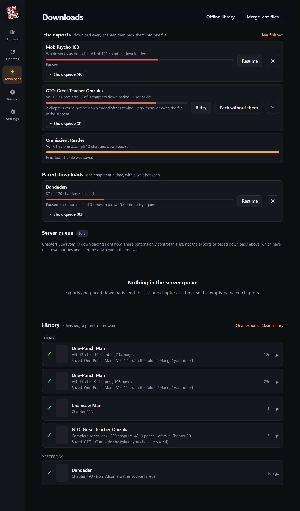
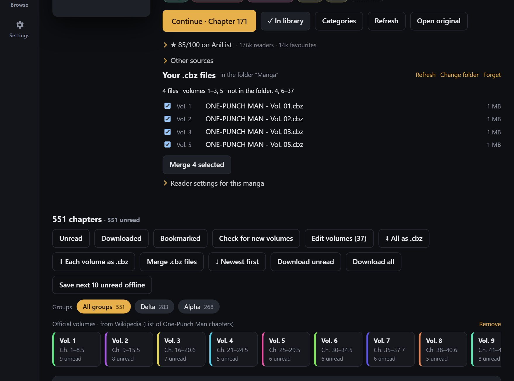
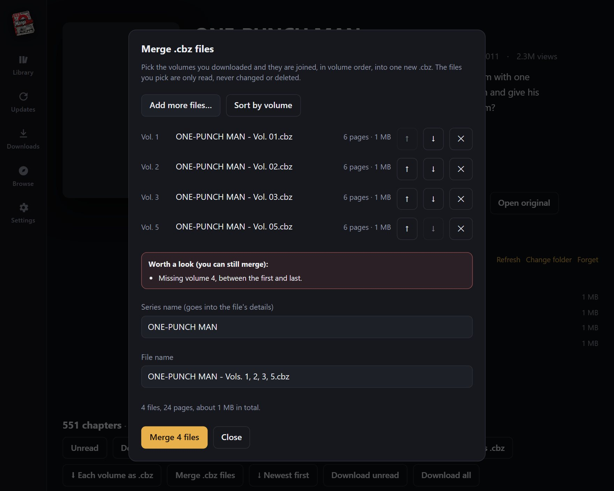
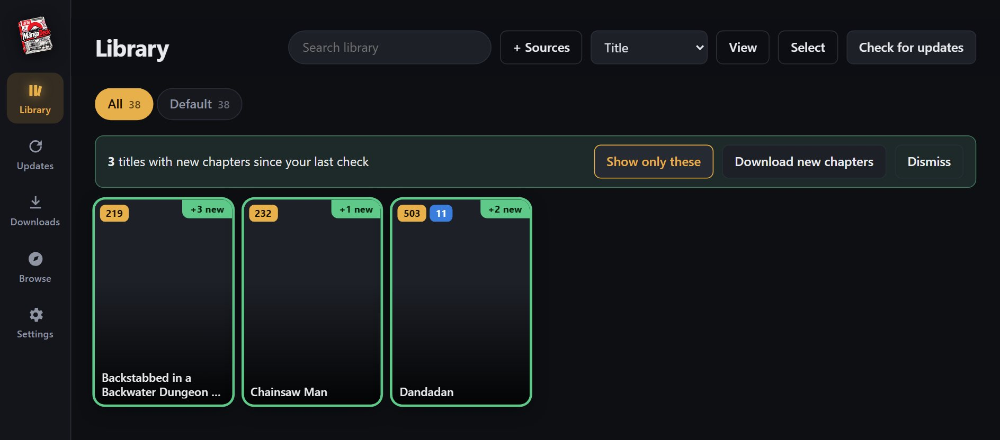
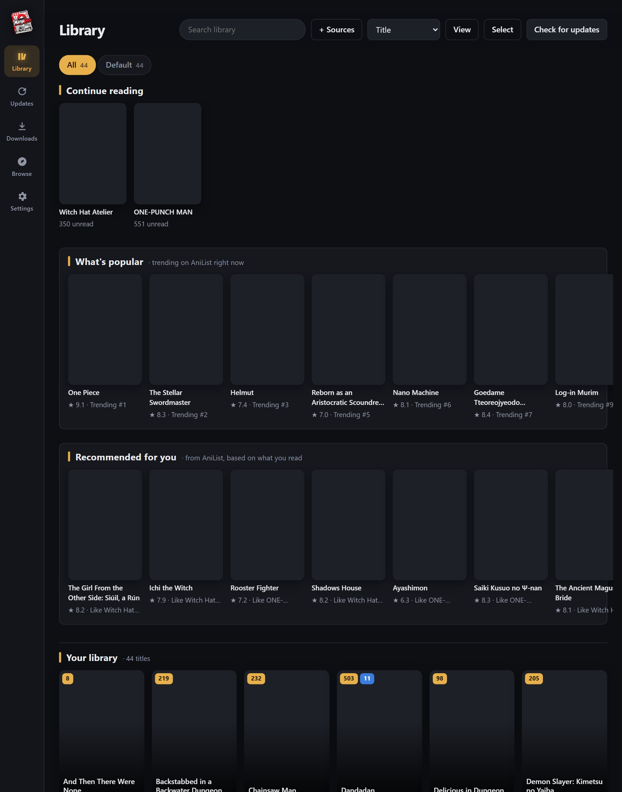
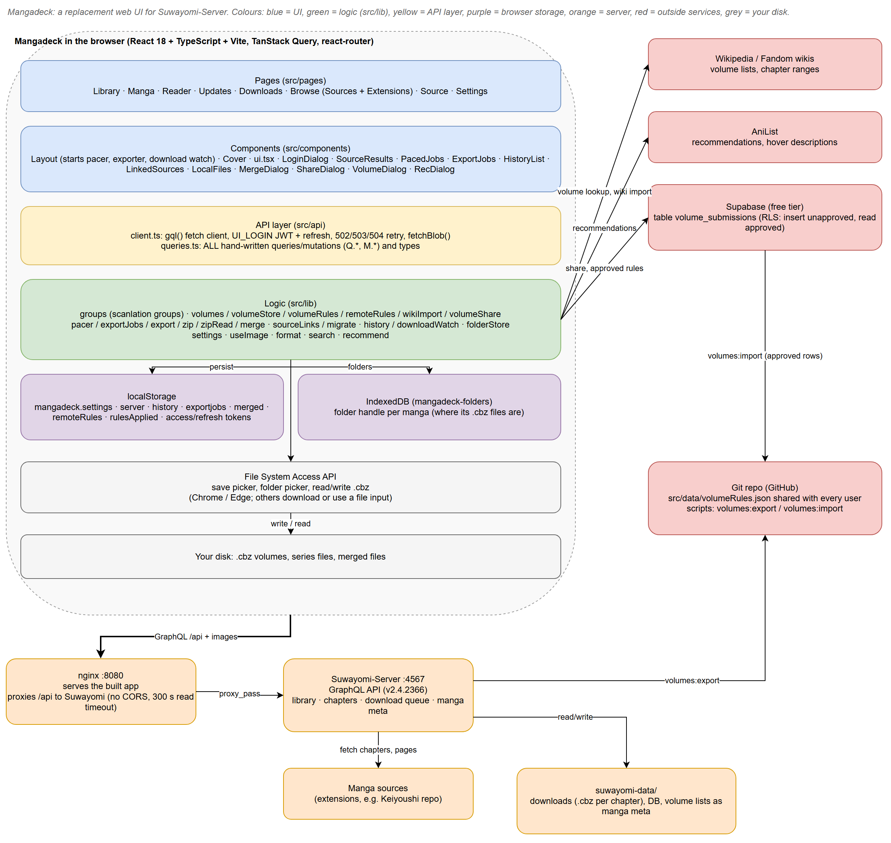
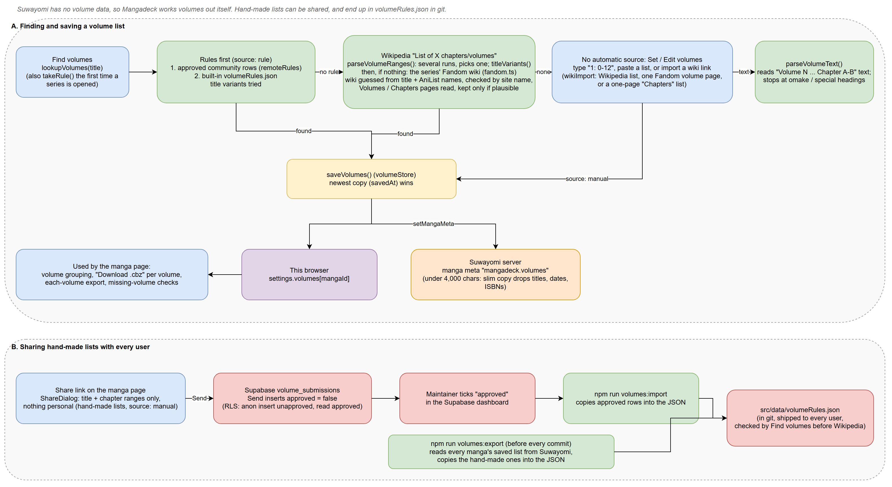
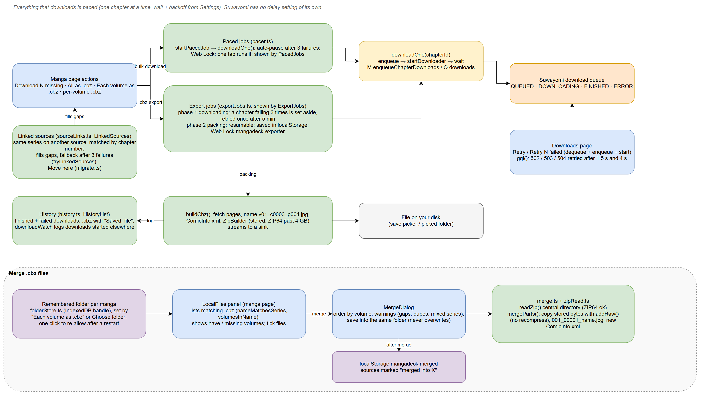

<p align="center">
  
</p>

# Mangadeck

A faster, denser replacement UI for [Suwayomi-Server](https://github.com/Suwayomi/Suwayomi-Server).
It keeps the Suwayomi server (and its whole Mihon/Tachiyomi extension ecosystem) and replaces only the
interface, talking to the server's GraphQL API at `/api/graphql`.

React + TypeScript + Vite, no UI framework, no GraphQL codegen. About 7k lines.

## Screenshots

Manga covers are blanked out in all screenshots; in the app they show the real covers.

### Downloads

Bulk downloads and `.cbz` exports are saved jobs that run one chapter at a time, show their progress here, and survive a reload. A chapter that keeps
failing is set aside (and retried at the end) instead of stopping the job; when something is still left, **Retry** or **Pack without them**. Every
finished download and file lands in the history, with where it was saved.



### Manga page: volumes, your files and merging

Official volumes come from Wikipedia, a series' Fandom wiki, the built-in/community rules, or your own list. Remember the folder you save a series' `.cbz`
files in and the page lists what you have, what is missing, and merges the volumes you tick into one file (in the same folder, the originals untouched).





### Library: new chapters and what's popular

After **Check for updates**, titles with new chapters get a green border and a "+N new" ribbon, and a bar offers to show only them or download the new
chapters. The library page is laid out in clear sections: Continue reading, **What's popular** (trending on AniList right now) and **Recommended for you**
in boxed shelves, then **Your library** with its title count. Clicking a recommendation searches all your sources.





## Run it

### Docker (recommended)

```bash
docker compose up -d --build
# open http://localhost:8080
```

The compose file starts Suwayomi and Mangadeck together. nginx serves the UI and proxies `/api` to Suwayomi,
so there is no CORS and nothing to configure. Data lives in `./suwayomi-data`.

Already have a Suwayomi running? Delete the `suwayomi` service from `docker-compose.yml` and start with:

```bash
SUWAYOMI_URL=http://192.168.1.50:4567 docker compose up -d --build
```

Already running Suwayomi in its own container (as on the author's machine, port 4567)? Do not run plain
`docker compose up`: it would start a second Suwayomi on the same port. Build only Mangadeck and point it at the
running one (on Docker Desktop, `host.docker.internal` reaches the host):

```powershell
$env:SUWAYOMI_URL='http://host.docker.internal:4567'; docker compose up -d --build --no-deps mangadeck
```

The image serves a built copy, so source edits show only after this is re-run (then hard-refresh the browser).

### Dev

```bash
npm install
echo "SUWAYOMI_URL=http://localhost:4567" > .env.local   # where your server is
npm run dev                                              # http://localhost:5173
```

`/api` is proxied by Vite, so the browser stays same-origin.

### Install as an app

Mangadeck is a PWA, so Chrome or Edge can install it as a desktop app with its own icon and window:

1. Open http://localhost:8080 (installing needs `localhost` or https; a plain `http://192.168.x.x` address will not offer it).
2. Click the install icon at the right of the address bar (Chrome: menu, **Cast, save and share**, **Install page as app**; Edge: **Apps**, **Install this site as an app**).
3. Launch it from the Start menu or desktop like any program.

It is the same web app in a frameless window, so Suwayomi still has to be running (`start-mangadeck.bat`). Prefer no install? Double-click
`open-mangadeck-app.bat` from this repo for the same frameless window. On a phone, open the address and use **Add to Home screen**.

### Auth

- **No auth / BASIC_AUTH / SIMPLE_LOGIN**: works through the browser (cookies and basic auth ride along on the same origin).
- **UI_LOGIN (JWT)**: a sign-in dialog appears automatically on a 401; tokens refresh on their own. Page images are
  fetched with the bearer token and shown from blob URLs.

## Tested

Run end to end in headless Chrome against a live **Suwayomi-Server v2.4.2366** (Local source with generated paged,
webtoon and CBZ series): library, categories, search/sort/filter, chapter selection, paged and webtoon readers,
resume and progress saving, mark-read on finish, updates, history, browse and mobile layout. Not yet exercised:
real extension sources, downloads of remote chapters, and UI_LOGIN auth.

## What's in it

| Area | Features |
| --- | --- |
| Library | Category tabs with counts, search (matches words anywhere in a title), sort (title, unread, last read, date added, latest chapter) with direction, unread/downloaded filters, cover size slider, unread/download badges, "Continue reading" shelf, **"What's popular"** shelf (AniList trending), "Recommended for you" shelf (up to 30 titles from AniList based on what you read recently; hover for the synopsis, "i" for details, click to search for it in your source), **+ Sources** to also search the typed title in your English sources, multi-select (add to category, remove), one-click "Check for updates" with progress, and a green border plus "+N new" ribbon on titles that gained chapters |
| Manga page | Blurred-cover header, readable synopsis with show more, collapsible genre tags, scanlation group bar (filter by group, "fill gaps from other groups", download all/unread per group; reader next/prev and `.cbz` exports follow it; with several groups and none chosen, Download all/unread asks first and then takes one copy of each chapter), **official volumes** (looked up from Wikipedia chapter lists, read from "Vol. N" in chapter names, found on the series' **Fandom wiki** when Wikipedia has nothing, imported from a Wikipedia or Fandom wiki link, or typed in by hand: a colored strip, volume dividers in the chapter list, filter by volume, select a whole volume), **download a volume or the whole series as one `.cbz`** with `ComicInfo.xml` metadata (writer, artist, genres, summary, release date, ISBN, chapter titles), a **Your .cbz files** panel (remembers the folder, lists which volumes you have and which are missing) and **merge .cbz files** into one (new volumes can be added to a complete-series file; chapters it already has are skipped), smart Continue/Start/Read-again button, categories, refresh, chapter filters (unread, downloaded, bookmarked), sort, shift-click range select, bulk mark read/unread, bookmark, download, delete downloads, per-manga reader settings |
| Reader | Paged (left to right by default, right to left if you pick it, globally or per manga) and webtoon modes, 4 fit modes, tap zones, swipe, keyboard, preloading, progress slider, resume position, auto mark-read, auto-download upcoming chapters, fullscreen |
| Updates | New chapters grouped by day, reading history, one-tap download |
| Downloads | Live queue with progress, start/pause, clear, remove. **Paced downloads**: bulk downloads (download all/unread, selections) go one chapter at a time with a randomised wait in between so a source does not ban you (Gentle / Normal / Fast presets or custom numbers, a longer break every N chapters, backoff and auto-pause when a source starts failing, pause/resume/cancel). **Show queue** on a job lists every chapter still waiting; a chapter that failed 3 times is marked and Resume retries it. **.cbz exports** ("⬇ All as .cbz" / a volume's ".cbz") are saved jobs: they download every chapter, then pack them into one file, show on this page with progress, and can be paused, resumed, skipped past a failing chapter, or cancelled. History at the bottom, with "Clear exports" / "Clear history" |
| Browse | English sources only (a setting shows other languages), popular/latest/search with load-more, search results filtered to titles that contain your words, extension install/update/uninstall, refresh repository |
| Offline | **Save for offline reading**: the ⤓ button on a chapter, **Save offline** on selected chapters, or **Save next 10 unread offline** keeps the pages on this device. Settings, Reader has **Save next chapters on this device while reading** (off by default) to do this on its own as you read; chapters saved that way are removed again once you finish them (a checkbox turns that off), while chapters you saved by hand stay. When the server cannot be reached the app still opens (it is installable), shows the last saved library and series pages with a notice, and opens saved chapters. Reading progress made meanwhile is sent when the server is back. **Offline library** (Downloads page) lists what is saved and what it costs, with remove buttons |
| Tracking | **AniList sync** (optional): connect your AniList account in Settings (you create a small client at anilist.co/settings/developer and paste its ID), and finishing a chapter or marking it read moves your AniList progress forward, never back, and marks the series Completed at its last chapter. Each series links to the AniList entry with exactly its title, or one you pick under "Track on AniList" on the series page, with **Send my progress** and **Get progress from AniList** (marks chapters read here up to the chapter AniList has for you). If AniList cannot be reached when you finish a chapter, the number is kept and sent automatically when it is back (Settings shows what is waiting) |
| Settings | Reader defaults, bulk download speed, a **preferred scanlation group** for every series that has it (a group picked on a manga's own page wins; **Show the groups in my library** lists every group with its series count and a Prefer button), **Find duplicate series** (the same title added from two sources, with Open / Remove), and **Backup**: download your browser-side data (group choices, linked sources, volume lists, history, library view) as one file and restore it on another computer |

Reader keys: `←/→` pages (direction-aware), `Space`/`Shift+Space`, `[` `]` chapters, `M` toggle menu, `F` fullscreen, `Esc` back.

## Layout

A diagram of how the parts fit together (overview, volumes and shared rules, downloads / exports / merge) is in [`docs/architecture.drawio`](docs/architecture.drawio). Open it with [diagrams.net](https://app.diagrams.net) or the draw.io desktop app or VS Code extension.

**How the parts fit together**



**Volumes and shared rules**



**Downloads, exports and merge**



The pictures are exported from the `.drawio` file. After editing the diagram, re-export the three pages to `docs/images/`.

```
src/api/client.ts     GraphQL client, auth, token refresh
src/api/queries.ts    every query/mutation + types (single file, easy to extend)
src/lib/settings.ts   persisted prefs (localStorage): reader, library, pacing, per-manga overrides, volume maps
src/lib/useImage.ts   image loading with optional bearer auth + preloading
src/lib/groups.ts     scanlation group filtering
src/lib/volumes.ts    official volumes: Wikipedia lookup + parser, chapter-to-volume mapping, typed/pasted volumes
src/lib/wikiImport.ts import volumes from a Wikipedia/Fandom link (follows "Manga Volume N" pages)
src/lib/volumeStore.ts  saves volume maps in the browser and on the Suwayomi server (manga meta)
src/lib/volumeRules.ts  built-in volume lists for series no automatic source can read (data: src/data/volumeRules.json)
scripts/                `npm run volumes:export` copies the volume lists you typed or imported from your server into that file
src/lib/fandom.ts     find a series' Fandom wiki and read its volume list when Wikipedia has none
src/lib/merge.ts      merge .cbz files (copies stored bytes, skips chapters already in an earlier file); zipRead.ts reads zips
src/lib/folderStore.ts  remembers the folder you save a series' .cbz files in (IndexedDB)
src/lib/export.ts     build a .cbz (pages + ComicInfo.xml), save to disk or download
src/lib/zip.ts        tiny dependency-free zip writer (stored, streams to a file)
src/lib/pacer.ts      paced bulk downloads: timing, one-chapter-at-a-time runner, saved jobs
src/lib/exportJobs.ts .cbz export jobs: download every chapter (paced), then pack one file; saved, resumable, shown on Downloads
src/lib/history.ts    log of finished downloads and exports (per browser)
src/lib/recommend.ts  AniList recommendations from your recent reads
src/lib/search.ts     word matching for search (any order, ignores case and accents)
src/lib/format.ts     dates (Suwayomi mixes seconds and milliseconds), description parsing
src/components/*      shared UI: cards, shelves with arrows, source search results, paced job list
src/pages/*           Library, Manga, Reader, Updates, Downloads, Browse, Source, Settings
src/styles.css        the whole design, driven by CSS variables at the top
public/               logo, icons, web app manifest and service worker (originals in branding/)
docs/screenshots/     README screenshots
```

Tests: `npm test` (Vitest) covers the parsing, pacing, zip, search, grouping, backup and date helpers.

Smoke test: `npm run smoke` opens the main pages in headless Chrome against your running Mangadeck (default `http://localhost:8080`, or set `SMOKE_URL`)
and fails on script errors, an empty library, a broken group list or group bar, a sideways-scrolling phone layout and similar. It only reads; add `-- --reader` to also open a chapter, or `-- --offline` to save one chapter, cut the network and read it.

## Notes

- The GraphQL shapes were taken from the official Suwayomi-WebUI source (current `master`). If a future server
  release renames a field, `src/api/queries.ts` is the only file to touch.
- Download progress and library updates are polled (2–5 s) rather than using GraphQL subscriptions.
- Two features talk to outside services straight from your browser: official volumes read Wikipedia
  (`en.wikipedia.org`) and recommendations read AniList (`graphql.anilist.co`). They send only a manga title. If you connect AniList tracking, your sign-in token (kept in this browser, never in a backup)
  and reading progress also go to AniList, and to nothing else.
  Nothing else leaves your network, and nothing breaks if they are unreachable.
- Paced downloads wait in the browser, so keep a Mangadeck tab open while a long job runs (a hidden tab slows its
  timers, which only makes the waits longer). The server has no download delay setting of its own.
- **.cbz exports and resuming**: an export job (`mangadeck.exportjobs` in localStorage) first downloads the missing chapters
  through Suwayomi, then packs all chapters into one zip. A chapter that fails 3 times (after 1 and 2 minute waits) is first tried on the series' linked sources
  (**Other sources** on the manga page; the copy from the other source goes into the file), and only if none has it is it
  set aside and the rest keep downloading; after a 5 minute cool-down the set-aside chapters get one more pass. If some
  still fail, the job pauses with **Retry** and **Pack without them** (the one file is written without those chapters,
  and the history entry names them). Page and image fetches while packing retry 4 times. A zip is written as one stream, so a failed or paused pack restarts the file, but downloaded
  chapters stay on the server, so that is quick. The browser only gives out a save location from a click, so it is kept
  in memory: after a page reload a job waiting to pack shows **Choose file**. Jobs run from `Layout` under a Web Lock
  (one tab). The zip writer uses ZIP64 records, so one file can pass 4 GB and 65k pages (unit-tested with tiny limits, not
  with a real 4 GB file). Without Chrome/Edge's save-to-disk the archive is built in memory, which browsers cap at about
  2 GB. Not yet tested end to end against a real series (the download and pause steps were).
- **Install as an app**: see [Install as an app](#install-as-an-app). The service worker keeps only the page itself and never caches `/api`,
  so chapters and images always come live.
- `.cbz` is a plain zip, not a RAR, so it opens in any comic reader; real `.cbr` needs WinRAR's tool.
- The stock WebUI keeps running inside Suwayomi; Mangadeck ignores it. Mangadeck is just another client of the
  same API, so you can use both side by side.

## Ideas for next steps

MyAnimeList sync, double-page spreads, a faster source migration, and reading chapters offline that were not saved first.
